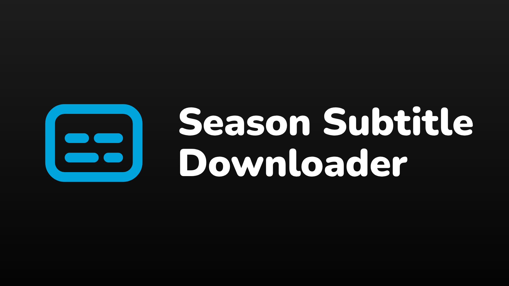
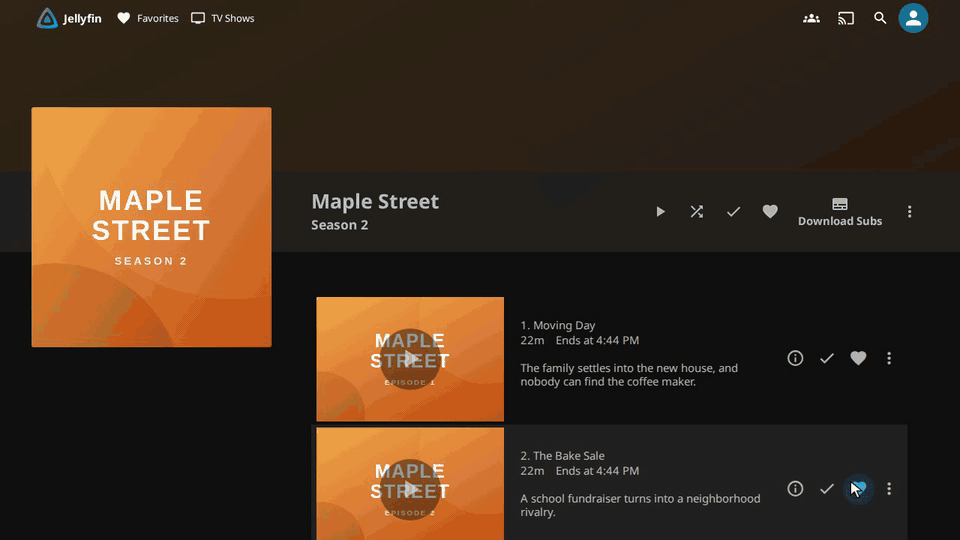

<div align="center">



Download subtitles for a whole season or series in one click, in as many languages as you need.

[](https://github.com/bmuraykhi/Sub-Jellyfin/releases/latest)
[](https://github.com/bmuraykhi/Sub-Jellyfin/actions/workflows/ci.yml)

</div>



## Install

You need Jellyfin 10.11 or newer, a working subtitle provider (such as the OpenSubtitles plugin) and the
[File Transformation](https://github.com/IAmParadox27/jellyfin-plugin-file-transformation) plugin. To get File
Transformation, add its catalog the same way as in step 1 and install it from there:

```
https://www.iamparadox.dev/jellyfin/plugins/manifest.json
```

1. Dashboard → **Plugins** → **Manage Repositories** → **+**, and add

   ```
   https://raw.githubusercontent.com/bmuraykhi/jellyfin-plugins/main/manifest.json
   ```

2. Find **Season Subtitle Downloader** in the catalog (**Available** on Jellyfin 12) → **Install**
3. Restart Jellyfin and hard-refresh the browser (Ctrl/Cmd+Shift+R).

The old `https://raw.githubusercontent.com/bmuraykhi/Sub-Jellyfin/main/manifest.json` catalog is retired at 3.0.0.0.
If you added it, replace it with the one above.

## Use

Open a season or series page and click **Download Subs**. Search for your languages, untick any episodes you want to
skip, and press **Start**. You can hide the dialog and keep browsing: the download carries on in a small card in the
corner. Failed episodes are listed with the reason, and **Retry Failed** runs just those again.

## Settings

Dashboard → Plugins → **Season Subtitle Downloader** sets what the dialog starts with, and checks that File
Transformation and a subtitle provider are installed:

| Setting | Default | Notes |
| --- | --- | --- |
| Default languages | your subtitle language, else English | the dialog starts with all of them |
| Skip episodes that already have subtitles | on | checked per language |
| Matches per episode | 1 | download the 1–5 best matches |
| Retries when a download fails | 2 | when the server or provider is busy or unreachable |
| Pause between episodes | 0 s | raise it if your provider limits requests |

## How it works

- File Transformation adds the plugin's script to Jellyfin's web page as it's served. No jellyfin-web files are
  changed, so it keeps working after web client updates.
- The script adds the **Download Subs** button and makes the same calls as Jellyfin's own subtitle search, one episode
  at a time, through the subtitle providers you already have.
- A download counts only once the new subtitle shows up on the episode: Jellyfin reports success even when the
  provider fails.
- Subtitles are saved wherever Jellyfin normally saves them. The plugin only stores its settings.
- Everything goes through your Jellyfin server. The plugin has no accounts, API keys or outside connections of its
  own.

## Troubleshooting

- **No Download Subs button:** the plugin's settings page says whether File Transformation is installed. Dashboard →
  Logs should show `Season Subtitle Downloader transformation registered.` Then hard-refresh the browser.
- **Everything says "no match":** the dialog warns if no subtitle provider is installed. Otherwise check the
  provider's login.
- **"The subtitle provider didn't deliver it":** usually the provider's login or daily download limit. Dashboard →
  Logs shows `Error downloading subtitles` with the provider's reason.

## License

The source is under [The Unlicense](LICENSE). The built plugin links against Jellyfin's GPL-3.0 libraries, so the
released DLL and zip are under the GPL-3.0.
