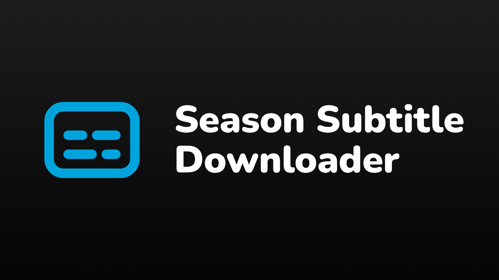
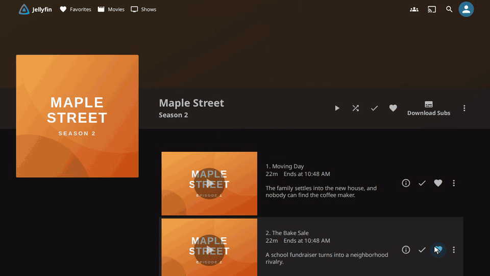

<div align="center">



# Season Subtitle Downloader

Download subtitles for a whole season or series in one click, in as many languages as you need.

[](https://github.com/bmuraykhi/Sub-Jellyfin/releases/latest)
[](https://github.com/bmuraykhi/Sub-Jellyfin/actions/workflows/ci.yml)

</div>



## Install

You need Jellyfin 10.11 or newer, a working subtitle provider (such as the OpenSubtitles plugin) and the
[File Transformation](https://github.com/IAmParadox27/jellyfin-plugin-file-transformation) plugin. To get File
Transformation, add its catalog the same way as in step 1 and install it from there:

```
https://www.iamparadox.dev/jellyfin/plugins/manifest.json
```

1. Dashboard → **Plugins** → **Manage Repositories** → **+**, and add

   ```
   https://raw.githubusercontent.com/bmuraykhi/jellyfin-plugins/main/manifest.json
   ```

2. **Catalog** → **Season Subtitle Downloader** → **Install**
3. Restart Jellyfin and hard-refresh the browser (Ctrl/Cmd+Shift+R).

The old `https://raw.githubusercontent.com/bmuraykhi/Sub-Jellyfin/main/manifest.json` catalog is retired at 3.0.0.0.
If you added it, replace it with the one above.

## Use

Open a season or series page and click **Download Subs**. Add your languages, untick any episodes you want to skip,
and press **Start**. Failed episodes are listed with the reason, and **Retry Failed** runs just those again.

## Settings

Dashboard → Plugins → **Season Subtitle Downloader** sets what the dialog starts with:

| Setting | Default | Notes |
| --- | --- | --- |
| Default language | your subtitle language, else English | |
| Skip episodes that already have one | on | checked per language |
| Retries per episode | 2 | only for network errors, 429 and 5xx |
| Delay between episodes | 0 ms | raise it if your provider limits requests |
| Variants per episode | 1 | download the 1–5 best matches |

## Troubleshooting

- **No Download Subs button:** Dashboard → Logs should show `Season Subtitle Downloader transformation registered.`
  If it says `File Transformation plugin not found`, install that plugin and restart. Then hard-refresh the browser.
- **Everything says "no match":** check your subtitle provider's login and quota.

## License

The source is under [The Unlicense](LICENSE). The built plugin links against Jellyfin's GPL-3.0 libraries, so the
released DLL and zip are under the GPL-3.0.
